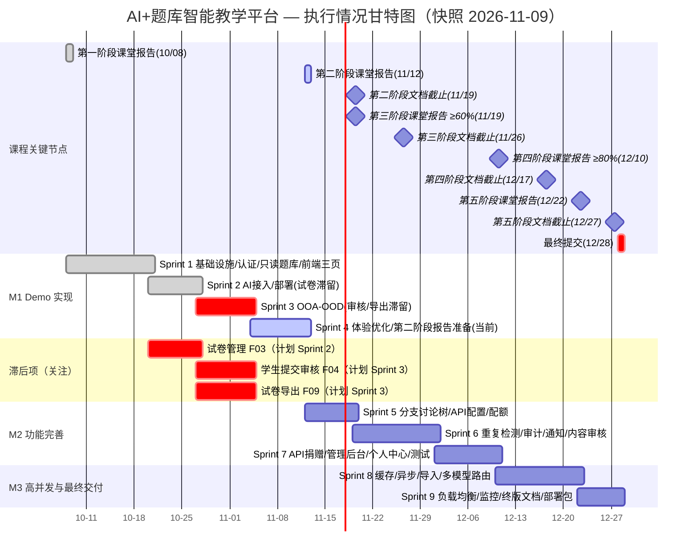

# AI+题库智能教学平台 — 项目执行情况甘特图

> 版本：v1.1 | 快照日期：2026-11-09 | 维护：戴儒骋（文档/项目经理）、卢恒毅（架构/测试）
> 编制依据：仓库 git 提交历史、`docs/项目开发时间轴.md`（计划口径）、`docs/AGENT.md`、`docs/architecture.md` 及 `server/src`、`web/js`、`ai-service` 代码现状。

本图反映**截至 2026-11-09（Sprint 4，第二阶段报告前）**的实际执行进度。状态已按上游 `Araaaagorn/ai-question-bank` 提交历史（最新 `2420bd4`，2026-11-08）与实际代码交叉核实，自上次同步后无新增提交。

## 图例

| 标记 | 含义 |
|------|------|
| ✅ | 已完成 |
| 🟡 | 进行中 / 部分完成 |
| ⬜ | 未开始 / 待办 |

---

## 一、执行甘特图（Mermaid）

> 颜色说明：`done`（已完成，绿）· `active`（当前进行，蓝）· `crit`（已过计划窗口仍有滞后，红）· 普通色（按计划推进）。
> Sprint 层色条表示整体节奏；具体每个功能单元的完成度以下方「执行情况对照表」为准。

---

## 二、执行情况对照表

### P0 — 核心功能（9 项）

| 编号 | 功能单元 | 负责人 | 计划 Sprint | 状态 | 实际进展 / 证据 |
|------|----------|--------|-------------|------|-----------------|
| F01 | 用户认证系统 | 刘英哲（后端）＋曹渲东/王英杰（前端） | Sprint 1 | ✅ 已完成 | 注册/登录/登出/`me`/角色（student·teacher·admin）；前端登录＋注册页（PR #19）；`auth` 测试组 8 用例 |
| F02 | 基础题库管理 | 李俊熠 | Sprint 1（只读）＋写接口补强 | ✅ 已完成 | 题目 CRUD 全链路：`GET /api/v1/questions[/{id}]`＋`POST/PUT/DELETE`（teacher/admin 鉴权，PR #15）；数据存 kv_store `qdata`；字段含知识点/难度/状态 |
| F03 | 基础试卷管理 | 李俊熠 | Sprint 2 | ⬜ 未开始 | 无 `/exams` 路由；试卷 CRUD、题目组织、顺序/分值均待开发 |
| F04 | 学生提交审核 | 牛宇歌 | Sprint 3 | ⬜ 未开始 | 现有 `POST /questions` 为教师直建题，学生提交→教师审核（通过/驳回）流程未实现 |
| F05 | AI 基础解答 | 刘英哲 | Sprint 2＋ | ✅ 已完成（方案升级） | 升级为内置 Pi 0.84.1 Agent 异步解题：`POST /api/v1/chat`（202）→ `GET /api/v1/chat/{job_id}`；含 solve/hint/review 技能、数学工具、30 案例质量评估（PR #14/#17） |
| F06 | 分支讨论树 | 刘英哲 | Sprint 5（部分提前） | 🟡 部分完成 | 对话上下文 `conversation_id` 多轮追问已具备；树状 Fork/折叠/推荐答案未实现 |
| F07 | API 配置管理 | 刘英哲 | Sprint 5（部分提前） | 🟡 部分完成 | 教师级 API 配置已实现（`/api/v1/teacher/ai-api` 的 GET/PUT/PATCH，Key 加密托管，PR #16）；多模型接入与统一管理界面未做 |
| F08 | 配额管理 | 刘英哲 | Sprint 5（部分提前） | 🟡 部分完成 | 学生/教师按日额度已实现（默认每日 20 次，PR #16）；多层级（教师/学生/题目）＋调用次数/Token/金额统计未做 |
| F09 | 试卷导出 | 李俊熠 | Sprint 3/6 | ⬜ 未开始 | PDF/Word/LaTeX/Markdown 导出均未实现 |

### P1 — 增强功能（5 项）

| 编号 | 功能单元 | 负责人 | 计划 Sprint | 状态 | 说明 |
|------|----------|--------|-------------|------|------|
| F10 | 重复问题检测 | 刘英哲 | Sprint 6 | ⬜ 未开始 | 向量检索＋语义相似度＋教师策略 |
| F11 | 内容审核 | 牛宇歌 | Sprint 6 | ⬜ 未开始 | 学生提交＋AI 生成内容审核 |
| F12 | 审计日志 | 卢恒毅 | Sprint 6 | 🟡 部分完成 | AI 授权操作已走事务审计（`scripts/ai_access.py`、ai_access 专用关系表）；通用操作/登录/Token 消耗审计待做 |
| F13 | 通知中心 | 牛宇歌 | Sprint 6 | ⬜ 未开始 | 系统通知/审核结果/额度告警 |
| F14 | API 捐赠 | 李俊熠 | Sprint 7 | ⬜ 未开始 | 学生向教师捐赠 API 资源 |

### P2 — 高级功能（5 项）

| 编号 | 功能单元 | 负责人 | 计划 Sprint | 状态 | 说明 |
|------|----------|--------|-------------|------|------|
| F15 | 多模型路由 | 刘英哲 | Sprint 8 | ⬜ 未开始 | 按题目类型/教师配置自动选模型 |
| F16 | 学习数据分析 | 待定 | Sprint 8 | ⬜ 未开始 | 学习记录分析/薄弱点/建议 |
| F17 | 题目导入引擎 | 李俊熠 | Sprint 8~9 | ⬜ 未开始 | Word/PDF/图片/LaTeX/Markdown/纯文本批量导入 |
| F18 | 管理员后台 | 待定 | Sprint 7 | ⬜ 未开始 | 用户/系统/供应商管理、备份恢复 |
| F19 | 个人中心 | 曹渲东/王英杰 | Sprint 7 | ⬜ 未开始 | 学习记录/提问历史/额度/通知 |

### 非功能 / 基础设施（7 项）

| 编号 | 功能单元 | 负责人 | 计划 Sprint | 状态 | 说明 |
|------|----------|--------|-------------|------|------|
| I01 | 项目基础设施 | 卢恒毅、李俊熠 | Sprint 1 | ✅ 已完成 | Git＋分支保护＋CI（`.github/workflows/ci.yml`）、C 框架、kv_store 存储层（PR #5）、users 迁移（PR #10/#13） |
| I02 | 部署与运维 | 卢恒毅 | Sprint 2 | 🟡 部分完成 | `deploy/systemd/` 与安装脚本已提交；生产环境正式上线待确认 |
| I03 | 缓存层 | 卢恒毅 | Sprint 8 | ⬜ 未开始 | Redis 热点缓存 |
| I04 | 异步任务系统 | 卢恒毅/刘英哲 | Sprint 8 | 🟡 部分完成 | AI 解题的异步队列已随 F05 落地（`ai-service/src/jobs.ts`，并行 4/等待 32）；通用消息队列/导出异步待做 |
| I05 | 数据库性能优化 | 卢恒毅 | Sprint 8 | ⬜ 未开始 | 索引/连接池/慢查询 |
| I06 | 负载均衡与水平扩展 | 卢恒毅 | Sprint 9 | ⬜ 未开始 | 多实例/无状态改造 |
| I07 | 监控与告警 | 卢恒毅 | Sprint 9 | ⬜ 未开始 | 监控/性能/报警/降级 |

---

## 三、里程碑达成情况

| 里程碑 | 时间窗口 | 目标 | 达成情况 |
|--------|----------|------|----------|
| M1 Demo 实现 | 10/08 – 10/27 | 最小可用系统（用户＋题库/试卷＋AI 解答） | 🟡 部分：用户/题库/AI 已可用；**试卷模块未完成**，M1 原定「题库→试卷」链路未闭合 |
| M2 功能完善 | 10/27 – 12/10 | ≥60%→≥80% 核心功能（P0 全量＋部分 P1） | ⬜ 进行中（当前处于 M2 早期） |
| M3 高并发与交付 | 12/10 – 12/28 | 高并发改造＋最终交付 | ⬜ 未开始 |

**课程节点（来自 `docs/项目开发时间轴.md`）：**

| 节点 | 日期 | 状态 |
|------|------|------|
| 第一阶段课堂报告 | 2026-10-08 | ✅ 已完成 |
| 第二阶段课堂报告（≥1 核心功能演示） | 2026-11-12 | 🟡 当前准备中 |
| 第二阶段文档截止（OOA/OOD、AI 使用报告等） | 2026-11-19 | 🟡 待完成 |
| 第三阶段课堂报告（≥60% 核心功能） | 2026-11-19 | ⬜ |
| 第四阶段课堂报告（≥80% 核心功能） | 2026-12-10 | ⬜ |
| 第五阶段课堂报告（最终展示） | 2026-12-22 | ⬜ |
| 全部材料最终提交 | 2026-12-28 23:59 | ⬜ |

---

## 四、计划 vs 实际偏差

**领先 / 超预期完成：**

- **F05 AI 解答**采用比原计划更完整的方案：独立 `ai-service/`（Node/TS + Pi 0.84.1）承担异步解题，含 hint/review 教学技能、受限数学工具、30 个评估案例；比原「后端 libcurl 直连单次问答」更稳健。
- **F02 题库写接口**提前闭合：在「只读→写接口待补」基础上已实现完整 CRUD（PR #15）。
- **F07/F08** 的教师 API 管理与学生配额随 PR #16 提前落地（原计划 Sprint 5）。

**滞后 / 需关注：**

- **F03 试卷管理**（计划 Sprint 2）、**F04 学生提交审核**、**F09 试卷导出**（计划 Sprint 3）三项 P0 均未开始，直接影响 M1「题库→试卷」链路与第二阶段 ≥60% 功能目标，建议下一 Sprint 优先排期。
- **I02 部署上线**尚未有可访问实例确认，需在第二阶段报告前尽快完成线上 Demo。

**存储方案演进（计划外重大调整）：**

- 原计划「关系表 SQL」为主，实际演进为「db.c 关系表（users/questions 骨架）＋ kv_store 目录式 KV」双轨：users/questions 已迁入 kv_store（PR #5/#10/#13），AI 授权/审计为专用关系表。相关接口见 `docs/kvstore.md`、`docs/ai-access.md`。

---

## 五、数据来源与核实结论

**核实结论（2026-11-09）**：本机直连 GitHub 被网络策略阻断，经 SSH `group2-server` 执行 `git fetch upstream` 取得上游最新引用，`upstream/main` 仍为 `2420bd4`（2026-11-08，PR #21），自上次同步后**无新增提交**；本地 `b66a2ff` 已含全部上游历史，代码与上游一致。下方功能状态据此逐条复核，未发生变更。

**上游主线提交记录（Squash merge，映射功能）**：

| 日期 | 提交 | 作者 | 功能 |
|------|------|------|------|
| 09-27 | 初始化框架 / 技术栈改 C / CI 修复 | Araaaagorn | I01 |
| 09-29 | demo auth（#1） | LyzZz55 | F01 |
| 10-05 | 题目 seed + 只读 API（#2） | AdmiralNagumo | F02 |
| 10-12 | kv_store 存储层（#5） | LyzZz55 | I01 |
| 10-13 | 注册 + users 迁 kv + session 清理（#10） | LyzZz55 | F01 |
| 10-14 | 文档体系完善（#11） | Komorebi | 文档 |
| 10-20 | kv store 2（#13）/ 前端 review 修复（#12） | LyzZz55 / Arnold4713 | I01/前端 |
| 10-22 | Pi 解题服务 + AI 授权 + 前端 1.2 契约（#14） | AdmiralNagumo | F05 |
| 10-30 | 题目 CRUD 写接口（#15） | Araaaagorn | F02 |
| 11-05 | 教师 API + 学生配额（#16）/ 前端 Pi（#17）/ 注册页（#19） | AdmiralNagumo / Arnold4713 | F07/F08/F05/F01 |
| 11-08 | 前端加载态/移动端（#20）/ 登出修复（#21） | Arnold4713 | 前端 |

**数据来源**：`git log --first-parent`、`docs/项目开发时间轴.md`、`docs/软件项目开发计划.md`、`docs/AGENT.md`、`docs/architecture.md`、`server/src/routes.c`、`server/tests/`、`ai-service/`、`web/`。